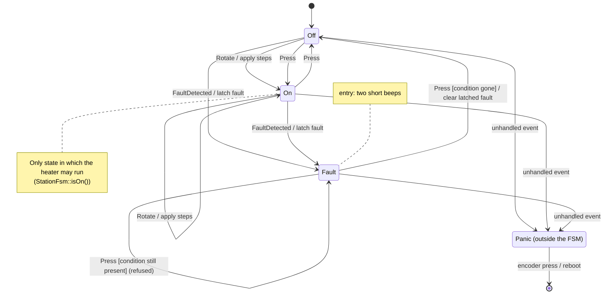

# Station state machine

Source: [src/station/StationFsm.h](../src/station/StationFsm.h). Events: [src/station/StationEvents.h](../src/station/StationEvents.h).

**Unhandled events.** Every state lists the events it handles. An event that reaches a state without a handler for it is a programming error. That state's `on_event_unknown()` calls `panic()` ([src/system/Panic.h](../src/system/Panic.h)), which:
1. turns the heater off and stops the software timers;
2. shows the event and the state on the display and over serial;
3. turns the Qwiic Twist LED red;
4. reboots on the next encoder press.

`panic()` never returns to the scheduler, so it's drawn as a pseudo-state outside the FSM.

| Event | Producer |
|---|---|
| `Rotate(steps)` | Qwiic Twist rotation, left (−1) and right (+1) buttons |
| `Press` | Qwiic Twist push, middle button |
| `FaultDetected(fault)` | `SafetyMonitor::check()` in the 100 ms measurement cycle, posted every cycle the condition is present |

**Fault sources** (`SafetyMonitor::Fault`): `OverTemperature` (tip above 450 °C), `ThermalRunaway` (duty ≥ 200 for 3 s while below 150 °C, without rising 20 °C), `HeaterSaturated` (duty ≥ 200 for 30 s without a break). Entering Fault beeps twice, since while soldering the user is likely not watching the screen.
